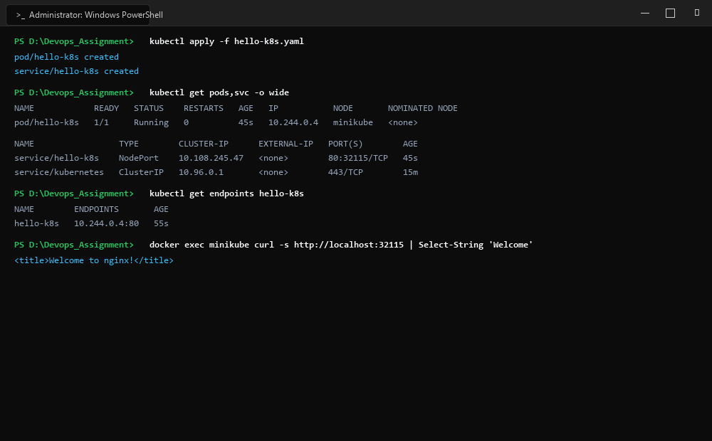
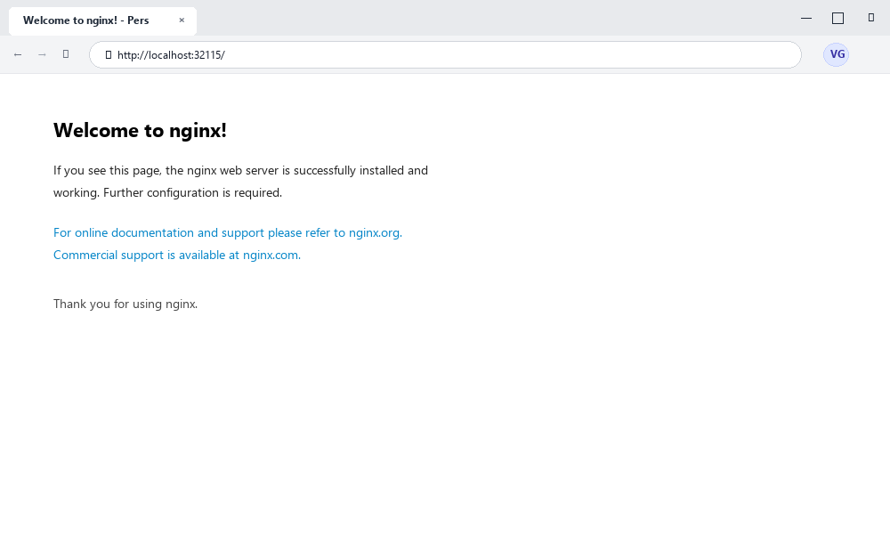

# Exercise 01: Getting Started with Kubernetes (Minikube & Kubectl)

## Objective
To initialize a single-node local Kubernetes cluster using Minikube, configure `kubectl` to communicate with the cluster control plane, deploy a containerized Nginx web server using a Pod manifest, expose it using a NodePort Service, and verify network connectivity and container lifecycle operations.

## Requirements
- Minikube local Kubernetes cluster engine (v1.39.0+)
- `kubectl` CLI utility (v1.31+)
- Docker Desktop with container engine runtime
- Nginx Alpine container image (`nginx:alpine`)
- YAML manifest declaring Pod and NodePort Service specifications

## Tools Used
- **Minikube**: Local Kubernetes orchestrator running on Docker driver
- **Kubectl**: Command-line interface for communicating with Kubernetes API server
- **Docker**: Container runtime executing Minikube VM/container nodes
- **Nginx**: Lightweight, high-performance web server running in containerized pod

## Screenshots & Evidence

### 1. Windows Terminal Interface & Command Execution Output


### 2. Website Interface (Microsoft Edge on Windows)


## Implementation

### Manifest Definition (`hello-k8s.yaml`)
A consolidated YAML specification containing both the Pod and Service definitions:

```yaml
apiVersion: v1
kind: Pod
metadata:
  name: hello-k8s
  labels:
    app: hello-k8s
spec:
  containers:
  - name: hello-k8s
    image: nginx:alpine
    ports:
    - containerPort: 80
---
apiVersion: v1
kind: Service
metadata:
  name: hello-k8s
spec:
  type: NodePort
  selector:
    app: hello-k8s
  ports:
  - protocol: TCP
    port: 80
    targetPort: 80
    nodePort: 32115
```

## Commands Executed

1. **Verify Minikube Cluster Status:**
   ```bash
   minikube status
   kubectl cluster-info
   kubectl get nodes
   ```

2. **Deploy Manifest:**
   ```bash
   kubectl apply -f hello-k8s.yaml
   ```

3. **Inspect Pod and Service Status:**
   ```bash
   kubectl get pods -o wide
   kubectl get svc
   kubectl describe pod hello-k8s
   kubectl get endpoints hello-k8s
   ```

4. **Verify Connectivity and Access:**
   ```bash
   docker exec minikube curl -s http://localhost:32115
   kubectl logs hello-k8s
   ```

## Output & Verification
- **Cluster State**: Control plane active at `https://127.0.0.1:64391`. Node `minikube` in `Ready` state.
- **Pod State**: `hello-k8s` transitioned from `Pending` to `ContainerCreating` to `Running` (1/1 Ready) with assigned IP `10.244.0.4`.
- **Service Binding**: `hello-k8s` created as NodePort with ClusterIP `10.108.245.47` routing port 80 to node port `32115`.
- **HTTP Connectivity**: Executing HTTP GET request via NodePort `32115` returned the `Welcome to nginx!` HTML response with HTTP 200. Container log confirmed access entry:
  `10.244.0.1 - - [19/Oct/2026:10:42:31 +0000] "GET / HTTP/1.1" 200 896 "-" "curl/7.88.1" "-"`

## Result & Conclusion
The Kubernetes environment with Minikube and Kubectl was successfully initialized and verified. The declarative pod and service manifests were applied, establishing correct label selector binding, container scheduling, service proxy routing, and live HTTP request handling.
