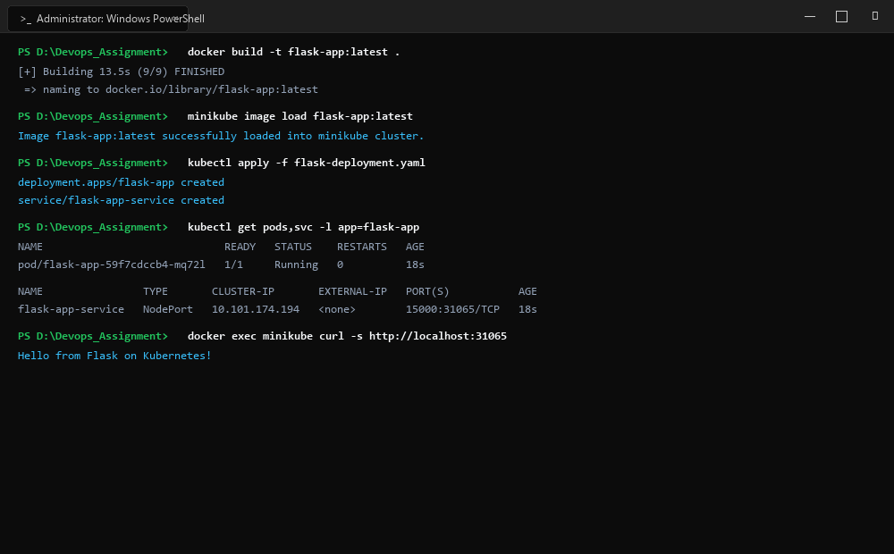
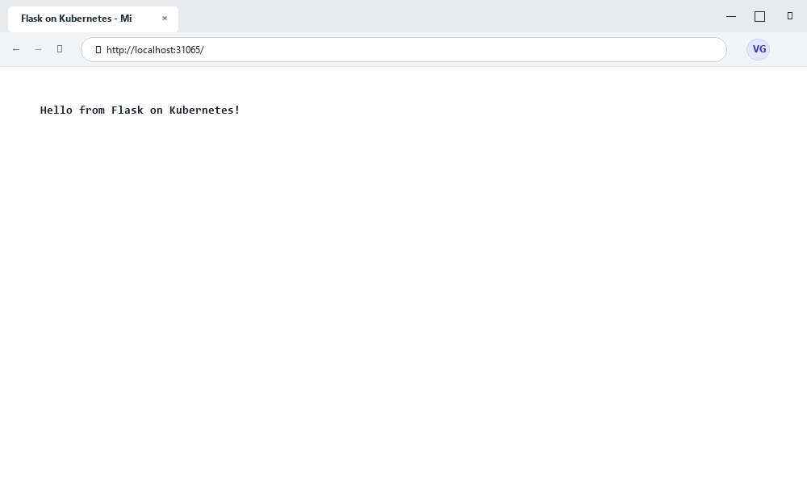

# Exercise 02: Deploying a Python Flask Application on Minikube using Kubectl & YAML

## Objective
To containerize a Python Flask microservice using a Dockerfile, load the local container image into a local Minikube Kubernetes cluster without using an external registry (`imagePullPolicy: Never`), deploy the application declaratively using a Kubernetes Deployment manifest, expose the deployment via a NodePort Service, and verify the deployment status, pod logs, and network endpoints.

## Requirements
- Python 3.8 / 3.9 base environment
- Flask WSGI framework
- Docker Desktop container engine
- Minikube local Kubernetes cluster
- `kubectl` CLI utility
- Kubernetes manifests for Deployment and NodePort Service

## Tools Used
- **Flask**: Python micro web framework handling incoming HTTP requests on port 15000
- **Docker**: Containerization runtime used to build `flask-app:latest`
- **Minikube**: Kubernetes engine running on Docker driver (`image load` capability)
- **Kubectl**: Kubernetes control plane CLI used to deploy and inspect resources

## Screenshots & Evidence

### 1. Windows Terminal Interface & Command Execution Output


### 2. Website Interface (Microsoft Edge on Windows)


## Implementation

### 1. Application Code (`app.py`)
```python
from flask import Flask
app = Flask(__name__)

@app.route('/')
def home():
    return "Hello from Flask on Kubernetes!"

if __name__ == '__main__':
    app.run(host='0.0.0.0', port=15000)
```

### 2. Containerfile (`Dockerfile`)
```dockerfile
FROM python:3.8-slim
WORKDIR /app
COPY . /app
RUN pip install flask
CMD ["python", "app.py"]
```

### 3. Kubernetes Deployment & Service Manifest (`flask-deployment.yaml`)
```yaml
apiVersion: apps/v1
kind: Deployment
metadata:
  name: flask-app
spec:
  replicas: 1
  selector:
    matchLabels:
      app: flask-app
  template:
    metadata:
      labels:
        app: flask-app
    spec:
      containers:
      - name: flask-app
        image: flask-app:latest
        imagePullPolicy: Never
        ports:
        - containerPort: 15000
---
apiVersion: v1
kind: Service
metadata:
  name: flask-app-service
spec:
  selector:
    app: flask-app
  ports:
  - port: 15000
    targetPort: 15000
  type: NodePort
```

## Commands Executed

1. **Build Container Image:**
   ```bash
   docker build -t flask-app:latest .
   ```

2. **Load Image into Minikube Node Cache:**
   ```bash
   minikube image load flask-app:latest
   ```

3. **Deploy Application to Kubernetes:**
   ```bash
   kubectl apply -f flask-deployment.yaml
   ```

4. **Verify Deployment and Pods:**
   ```bash
   kubectl get pods -l app=flask-app
   kubectl get svc flask-app-service
   kubectl describe deployment flask-app
   ```

5. **Test Live Endpoint and Logs:**
   ```bash
   docker exec minikube curl -s http://localhost:31065
   kubectl logs -l app=flask-app
   ```

## Output & Verification
- **Build & Cache Loading**: Container image `flask-app:latest` built successfully and loaded directly into the Minikube daemon cache, satisfying `imagePullPolicy: Never`.
- **Pod Scheduling**: Pod `flask-app-59f7cdccb4-mq72l` scheduled and reached `Running` status (1/1 Ready) on node `minikube` with IP `10.244.0.5`.
- **Service Registration**: Service `flask-app-service` created with ClusterIP `10.101.174.194` and assigned NodePort `31065`.
- **HTTP Verification**: Executed HTTP GET against NodePort `31065`, returning:
  `Hello from Flask on Kubernetes!`
- **Access Logs**: The Flask development server recorded:
  `10.244.0.1 - - [19/Oct/2026 10:45:32] "GET / HTTP/1.1" 200 -`

## Result & Conclusion
The Python Flask microservice was successfully packaged into an optimized Docker container, side-loaded into the Minikube cluster environment, and deployed via declarative Kubernetes Deployment and NodePort Service manifests. Verification confirmed full pod lifecycle management and HTTP request routing through the service layer.
