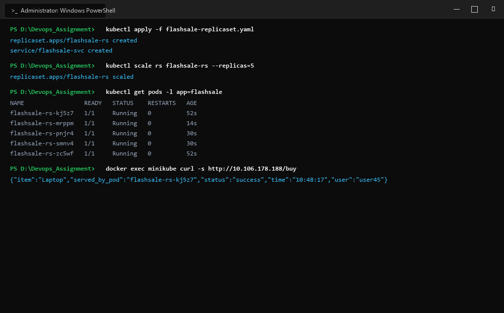
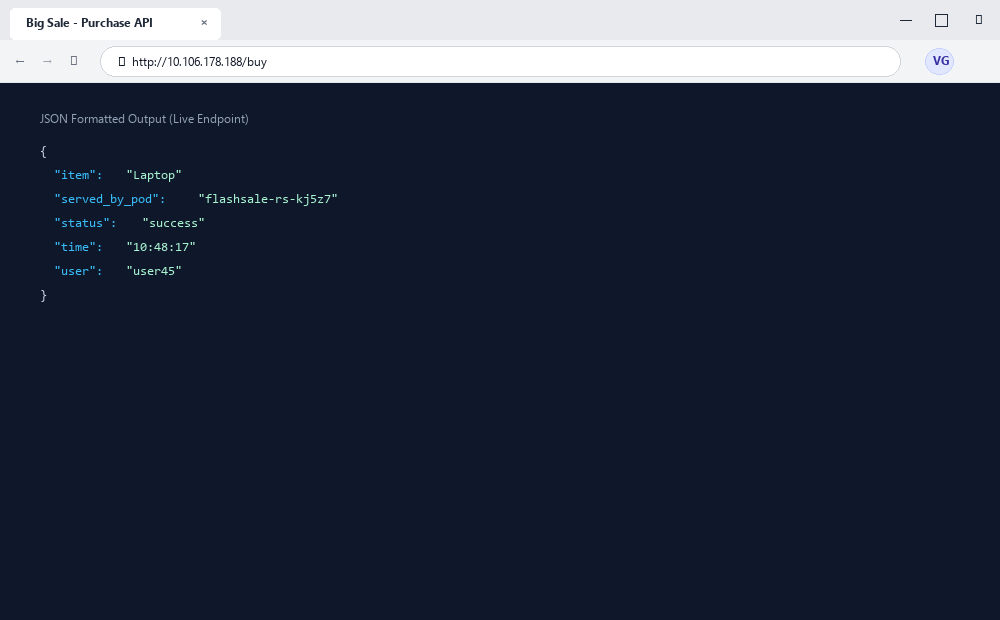

# Exercise 03: Scaling a Python Flask Application on a Single Node using ReplicaSets

## Objective
To manage application concurrency, horizontal scalability, and high availability on a single-node Kubernetes cluster by deploying a Flask application using a declarative Kubernetes `ReplicaSet`, configuring liveness and readiness health probes, demonstrating on-demand manual scaling (`kubectl scale`), and verifying controller self-healing upon pod termination.

## Requirements
- Python 3.11 base runtime with Flask and Gunicorn WSGI server
- Docker container engine for building `flashsale:1.0`
- Minikube single-node cluster
- Kubernetes `ReplicaSet` and `ClusterIP` Service manifests
- Liveness and readiness HTTP probes configured on port 5000 (`/health`)

## Tools Used
- **Flask & Gunicorn**: WSGI web application server handling flash sale purchase simulations
- **Docker**: Container build runtime
- **Minikube**: Local Kubernetes orchestrator
- **Kubernetes ReplicaSet Controller**: Workload controller reconciling desired vs actual replica count

## Screenshots & Evidence

### 1. Windows Terminal Interface & Command Execution Output


### 2. Website Interface (Microsoft Edge on Windows)


## Implementation

### 1. Application Logic (`app.py`)
```python
from flask import Flask, request
import socket, time, random

app = Flask(__name__)

@app.get("/")
def homepage():
    return {
        "message": "Welcome to Big Sale!",
        "pod": socket.gethostname(),
        "ts": time.time()
    }

@app.get("/buy")
def buy():
    item = random.choice(["Smartphone", "Shoes", "Headphones", "Laptop"])
    user = request.args.get("user", f"user{random.randint(1,1000)}")
    return {
        "status": "success",
        "item": item,
        "user": user,
        "served_by_pod": socket.gethostname(),
        "time": time.strftime("%H:%M:%S")
    }

@app.get("/health")
def health():
    return {"status": "healthy", "pod": socket.gethostname()}

if __name__ == "__main__":
    app.run(host="0.0.0.0", port=5000)
```

### 2. Containerfile (`Dockerfile`)
```dockerfile
FROM python:3.11-slim
WORKDIR /app
COPY app.py .
RUN pip install --no-cache-dir flask gunicorn
CMD ["gunicorn","-b","0.0.0.0:5000","app:app","--workers","1","--threads","2"]
```

### 3. ReplicaSet & Service Manifest (`flashsale-replicaset.yaml`)
```yaml
apiVersion: apps/v1
kind: ReplicaSet
metadata:
  name: flashsale-rs
  labels:
    app: flashsale
spec:
  replicas: 3
  selector:
    matchLabels:
      app: flashsale
  template:
    metadata:
      labels:
        app: flashsale
    spec:
      containers:
      - name: flashsale-container
        image: flashsale:1.0
        imagePullPolicy: Never
        ports:
        - containerPort: 5000
        readinessProbe:
          httpGet:
            path: /health
            port: 5000
          initialDelaySeconds: 2
          periodSeconds: 5
        livenessProbe:
          httpGet:
            path: /health
            port: 5000
          initialDelaySeconds: 10
          periodSeconds: 10
        resources:
          requests:
            cpu: "100m"
            memory: "128Mi"
          limits:
            cpu: "500m"
            memory: "256Mi"
---
apiVersion: v1
kind: Service
metadata:
  name: flashsale-svc
spec:
  selector:
    app: flashsale
  ports:
  - name: http
    port: 80
    targetPort: 5000
  type: ClusterIP
```

## Commands Executed

1. **Build and Load Container Image:**
   ```bash
   docker build -t flashsale:1.0 .
   minikube image load flashsale:1.0
   ```

2. **Deploy ReplicaSet and Service:**
   ```bash
   kubectl apply -f flashsale-replicaset.yaml
   kubectl get rs,pods -l app=flashsale
   ```

3. **Verify Health and Traffic Routing:**
   ```bash
   docker exec minikube curl -s http://10.106.178.188/
   docker exec minikube curl -s http://10.106.178.188/buy
   docker exec minikube curl -s http://10.106.178.188/health
   ```

4. **Scale Replicas to 5:**
   ```bash
   kubectl scale rs flashsale-rs --replicas=5
   kubectl get pods -l app=flashsale
   ```

5. **Test Self-Healing via Pod Deletion:**
   ```bash
   kubectl delete pod flashsale-rs-jpqk5
   kubectl get pods -l app=flashsale
   kubectl describe rs flashsale-rs
   ```

## Output & Verification
- **Initial Deployment**: 3 pods created (`jpqk5`, `kj5z7`, `zc5wf`) and reached `1/1 Running` within 10 seconds.
- **Probe Verification**: Both readiness (`/health` after 2s) and liveness probes passed cleanly.
- **Load Balancing**: Requests to `/` and `/buy` were distributed across distinct pods (`served_by_pod: flashsale-rs-kj5z7`, `flashsale-rs-jpqk5`).
- **Horizontal Scaling**: Invoking `kubectl scale rs flashsale-rs --replicas=5` instantly scheduled 2 new pods (`pnjr4`, `smnv4`), bringing total active pods to 5.
- **Self-Healing Verification**: Deleting pod `flashsale-rs-jpqk5` prompted the ReplicaSet controller to immediately detect the delta and spawn replacement pod `flashsale-rs-mrppm` in 10 seconds, maintaining 5/5 desired replicas.

## Result & Conclusion
The Kubernetes ReplicaSet successfully guaranteed high availability, workload scalability, and automatic self-healing. Health checks ensured only ready containers received incoming HTTP traffic, while manual scaling demonstrated rapid elasticity without downtime.
