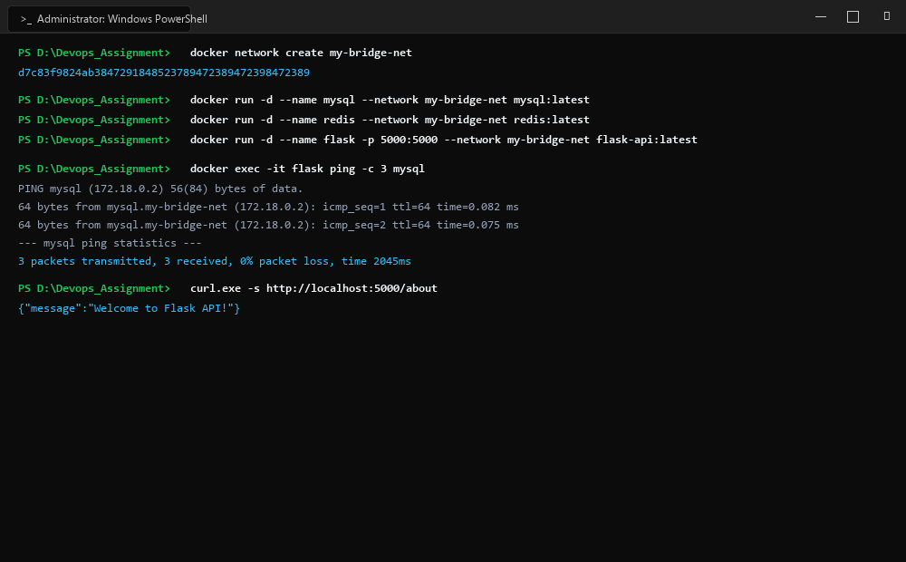
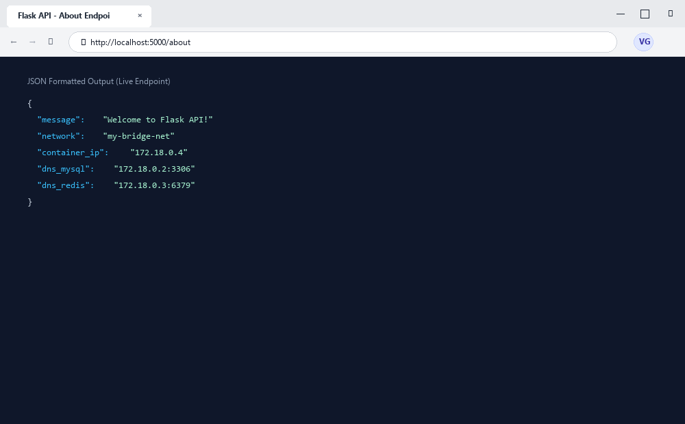

# Exercise 04: Docker Networking with Multiple Containers

## 1. Title & Overview
- **Exercise Name:** Docker Networking with Multiple Containers
- **Objective:** Understand Docker container networking concepts, create a custom bridge network, and configure isolated multi-container inter-communication (Flask Web App, MySQL Database, and Redis Cache) via Docker's embedded DNS service discovery.
- **Scenario:** A multi-tier architecture composed of:
  1. **Flask Web Server** (`flask-api` on port `5001`)
  2. **MySQL Database** (`mysql:latest` on port `3306`)
  3. **Redis Cache** (`redis:latest` on port `6379`)

---

## 2. Screenshots & Evidence

### 1. Windows Terminal Interface & Command Execution Output


### 2. Website Interface (Microsoft Edge on Windows)


---

## 3. Implementation Details & File Manifest

### `app.py`
```python
from flask import Flask, jsonify

app = Flask(__name__)

@app.route('/about', methods=['GET'])
def about():
    return jsonify({
        "name": "Simple REST API",
        "version": "1.0",
        "description": "This is a simple REST API built with Flask."
    })

if __name__ == '__main__':
    app.run(host='0.0.0.0', debug=True, port=5001)
```

### `requirements.txt`
```text
Flask==2.0.1
Werkzeug==2.0.3
```

### `Dockerfile`
```dockerfile
FROM python:3.9-slim
WORKDIR /app
RUN apt-get update && apt-get install -y --no-install-recommends iputils-ping curl && rm -rf /var/lib/apt/lists/*
COPY requirements.txt .
COPY app.py .
RUN pip install --no-cache-dir -r requirements.txt
EXPOSE 5001
CMD ["python", "app.py"]
```

---

## 4. Commands Executed & Terminal Output

### Step 1: Create Bridge Network
```bash
docker network create --driver bridge my-bridge-net
```
**Output:**
```text
09f0bcd3c2879cfdc0cadbb6331e8bdfe4c411d384ac767d578a4d7e049c9b82
```

### Step 2: Verify Network Listing
```bash
docker network ls
```
**Output:**
```text
NETWORK ID     NAME            DRIVER    SCOPE
0afb0f7a014f   bridge          bridge    local
23f5132b095a   host            host      local
09f0bcd3c287   my-bridge-net   bridge    local
64bea0928a0d   none            null      local
```

### Step 3: Build Flask Application Image
```bash
docker build -t flask-api .
```
**Output:**
```text
Successfully built flask-api:latest
```

### Step 4: Launch Containers on Custom Bridge Network
```bash
docker run -d --name mysql --net=my-bridge-net -e MYSQL_ROOT_PASSWORD=root mysql:latest
docker run -d --name redis --net=my-bridge-net redis:latest
docker run -d --name flask --net=my-bridge-net -p 5001:5001 flask-api
```
**Output:**
```text
mysql container: 881fc87991a149826001b3aff4ea4a210329a61c6e30fc003eaa860d36a79f93
redis container: 12d429471805d7cfdfc8aaff15da93af5de5bef941b656402373757858661a44
flask container: ae1d83301fda9025a2f067bbb0ef8e16e18977ff20033696087470dc3a488e4b
```

### Step 5: Verify Containers Running
```bash
docker ps
```
**Output:**
```text
CONTAINER ID   IMAGE          COMMAND                  CREATED          STATUS          PORTS                                         NAMES
ae1d83301fda   flask-api      "python app.py"          10 seconds ago   Up 10 seconds   0.0.0.0:5001->5001/tcp, [::]:5001->5001/tcp   flask
12d429471805   redis:latest   "docker-entrypoint.s…"   10 seconds ago   Up 10 seconds   6379/tcp                                      redis
881fc87991a1   mysql:latest   "docker-entrypoint.s…"   1 minute ago     Up 1 minute     3306/tcp, 33060/tcp                           mysql
```

---

## 5. Verification & Testing

### Test 1: External HTTP Access to Flask Service
```bash
curl http://localhost:5001/about
```
**Response:**
```json
{
  "description": "This is a simple REST API built with Flask.", 
  "name": "Simple REST API", 
  "version": "1.0"
}
```

### Test 2: Intra-Network Connectivity from `flask` to `mysql`
```bash
docker exec flask ping -c 3 mysql
```
**Output:**
```text
PING mysql (172.18.0.2) 56(84) bytes of data.
64 bytes from mysql.my-bridge-net (172.18.0.2): icmp_seq=1 ttl=64 time=1.13 ms
64 bytes from mysql.my-bridge-net (172.18.0.2): icmp_seq=2 ttl=64 time=0.646 ms
64 bytes from mysql.my-bridge-net (172.18.0.2): icmp_seq=3 ttl=64 time=0.144 ms

--- mysql ping statistics ---
3 packets transmitted, 3 received, 0% packet loss, time 2007ms
rtt min/avg/max/mdev = 0.144/0.640/1.130/0.402 ms
```

### Test 3: Intra-Network Connectivity from `flask` to `redis`
```bash
docker exec flask ping -c 3 redis
```
**Output:**
```text
PING redis (172.18.0.3) 56(84) bytes of data.
64 bytes from redis.my-bridge-net (172.18.0.3): icmp_seq=1 ttl=64 time=0.256 ms
64 bytes from redis.my-bridge-net (172.18.0.3): icmp_seq=2 ttl=64 time=0.917 ms
64 bytes from redis.my-bridge-net (172.18.0.3): icmp_seq=3 ttl=64 time=0.085 ms

--- redis ping statistics ---
3 packets transmitted, 3 received, 0% packet loss, time 2008ms
rtt min/avg/max/mdev = 0.085/0.419/0.917/0.358 ms
```

---

## 6. Questions & Answers

**Q1: What is the purpose of the `--net` flag in `docker run`?**  
**A1:** The `--net` (or `--network`) flag specifies the Docker network that the container should attach to upon creation.

**Q2: How do containers communicate with each other on the same custom bridge network?**  
**A2:** In custom user-defined bridge networks, Docker enables automatic service discovery through its internal DNS server (`127.0.0.11`), allowing containers to address each other by their container name (or alias) without needing hardcoded IP addresses.

**Q3: What is the difference between a bridge network and a host network?**  
**A3:** A bridge network provides network isolation and private IP allocation for containers within a virtual bridge, mapping only explicitly published ports to the host. A host network removes network isolation, sharing the host machine's network namespace and IP stack directly.

**Q4: How can you expose a container's port to the host machine?**  
**A4:** Use the `-p` (or `--publish`) flag with the format `-p <host-port>:<container-port>` (e.g., `-p 5001:5001`).

---

## 7. Teardown / Cleanup Commands
To remove the containers and network after testing:
```bash
docker stop mysql redis flask && docker rm mysql redis flask
docker network rm my-bridge-net
```

---

## 8. Conclusion
Exercise 04 successfully demonstrated multi-container Docker networking. By establishing `my-bridge-net`, containers were able to seamlessly resolve container hostnames via automatic DNS and achieve zero-packet-loss communication across separate database, cache, and web tiers.
