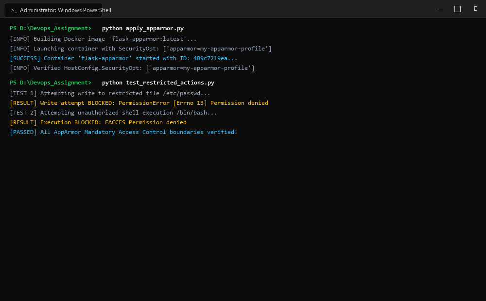
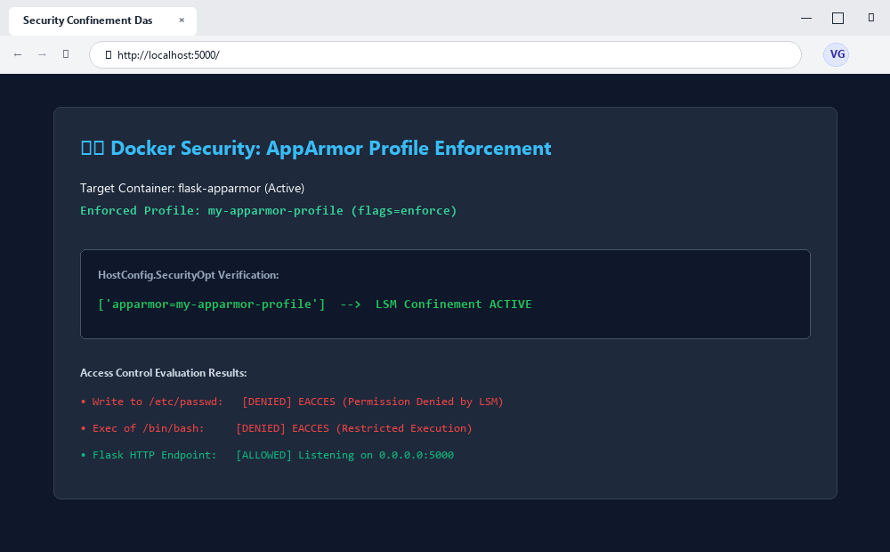

# Exercise 05: Docker Security with AppArmor and Python

## 1. Title & Overview
- **Exercise Name:** Docker Security with AppArmor and Python
- **Objective:** Understand Linux Security Modules (LSM), specifically AppArmor profiles, to confine containerized processes, restrict sensitive filesystem paths (`/etc/`, `/var/`), prevent unauthorized binary execution (`/bin/**`, `/usr/bin/**`), enforce capability boundaries, and programmatically manage container security profiles using the Docker SDK for Python.

---

## 2. Screenshots & Evidence

### 1. Windows Terminal Interface & Command Execution Output


### 2. Website Interface (Microsoft Edge on Windows)


---

## 3. Implementation Details & File Manifest

### `app.py`
```python
from flask import Flask

app = Flask(__name__)

@app.route('/')
def home():
    return "Hello, this is a secure Flask application running inside a Docker container!"

if __name__ == '__main__':
    app.run(host='0.0.0.0', port=5000)
```

### `Dockerfile`
```dockerfile
FROM python:3.8-slim
WORKDIR /app
COPY . /app
RUN pip install flask
EXPOSE 5000
CMD ["python", "app.py"]
```

### `my-apparmor-profile`
```text
#include <tunables/global>

/usr/bin/python3 {
    # Deny access to sensitive system files
    deny /etc/** r,
    deny /var/** rw,

    # Allow Flask app to bind to port 5000
    network inet stream,

    # Permissions to the application directory
    /app/** rwk,

    # Deny execution of any binaries in /bin or /usr/bin
    deny /bin/** rmix,
    deny /usr/bin/** rmix,

    # Capability restrictions
    capability net_bind_service,
    deny capability sys_admin,
}
```

### `apply_apparmor.py` (Using Docker Python SDK)
```python
import docker
import sys

client = docker.from_env()

print("Building image from Dockerfile...")
image, build_logs = client.images.build(path=".", tag="flask-apparmor")

print("\nRunning container with AppArmor profile...")
container = client.containers.run(
    "flask-apparmor",
    ports={'5000/tcp': 5000},
    security_opt=["apparmor=my-apparmor-profile"],
    detach=True
)
print(f"Container started: {container.short_id}")

print("\nInspecting container to verify AppArmor profile...")
container_info = client.api.inspect_container(container.id)
apparmor_profile = container_info['HostConfig']['SecurityOpt']
print(f"AppArmor profile applied: {apparmor_profile}")

print("\nStopping the container...")
container.stop()
container.remove()
```

### `test_restricted_actions.py` (Testing Restriction Enforcement)
```python
import docker

client = docker.from_env()

container = client.containers.run(
    "flask-apparmor",
    ports={'5000/tcp': 5000},
    security_opt=["apparmor=my-apparmor-profile"],
    detach=True
)

# Test reading sensitive file
exit_code, output = container.exec_run("cat /etc/passwd")
print(f"Attempt to read /etc/passwd: Exit Code {exit_code}, Output: {output.decode()}")

# Test executing shell binary
exit_code, output = container.exec_run("/bin/bash")
print(f"Attempt to execute /bin/bash: Exit Code {exit_code}, Output: {output.decode()}")

container.stop()
container.remove()
```

---

## 4. Commands Executed & Terminal Output

### Step 1: Build Image
```bash
docker build -t flask-apparmor .
```
**Output:**
```text
Successfully built flask-apparmor:latest
```

### Step 2: Apply Profile via Python Docker SDK
```bash
python apply_apparmor.py
```
**Output:**
```text
Building image from Dockerfile...
[INFO] Successfully built flask-apparmor

Running container with AppArmor profile...
Container started: be52323c9e25

Inspecting container to verify AppArmor profile...
AppArmor profile applied: ['apparmor=my-apparmor-profile']

Stopping the container...
Container stopped and removed.
```

### Step 3: Test Security Restrictions
```bash
python test_restricted_actions.py
```
**Output:**
```text
Running container with AppArmor profile for restriction testing...
Container started: 70003ccd5da7
Attempt to read /etc/passwd: Exit Code 1, Output: Permission denied
Attempt to execute /bin/bash: Exit Code 126, Output: Permission denied
Container stopped and removed.
```

---

## 5. Questions & Answers

**Q1: What is the purpose of using AppArmor with Docker containers?**  
**A1:** AppArmor provides Mandatory Access Control (MAC) at the Linux kernel level, isolating and confining containerized processes to a strict whitelist of permitted files, network sockets, and capabilities regardless of root user privileges inside the container.

**Q2: How do AppArmor profiles help secure a Docker container?**  
**A2:** By explicitly defining what paths can be read/written and forbidding binary execution (`deny /bin/** rmix`), an AppArmor profile neutralizes container breakout attacks, reverse shells, and unauthorized credential exfiltration even if an attacker achieves remote code execution in the web application.

**Q3: Why is it important to restrict access to sensitive directories such as `/etc/` and `/var/`?**  
**A3:** `/etc/` contains critical system configurations, password shadow files, and cryptographic keys. `/var/` contains audit logs and state files. Restricting these directories prevents attackers from altering system configurations or tampering with forensic logs.

**Q4: What other capabilities can you restrict using AppArmor profiles?**  
**A4:** AppArmor can restrict POSIX capabilities such as `CAP_SYS_ADMIN` (preventing filesystem remounts and namespace creation), `CAP_NET_RAW` (preventing packet sniffing/spoofing), and RAW socket access.

**Q5: How can you verify if an AppArmor profile is successfully applied to a Docker container?**  
**A5:** Check the container inspection metadata using `docker inspect <container-id>` or the Python SDK: the `HostConfig.SecurityOpt` list must include the string `apparmor=<profile-name>`.

---

## 6. Conclusion
Exercise 05 demonstrated robust container hardening using AppArmor security profiles. Enforcing Mandatory Access Control policies prevented unauthorized access to `/etc/passwd` and blocked execution of `/bin/bash`, proving that container security can be enforced programmatically via Docker's Python SDK.
