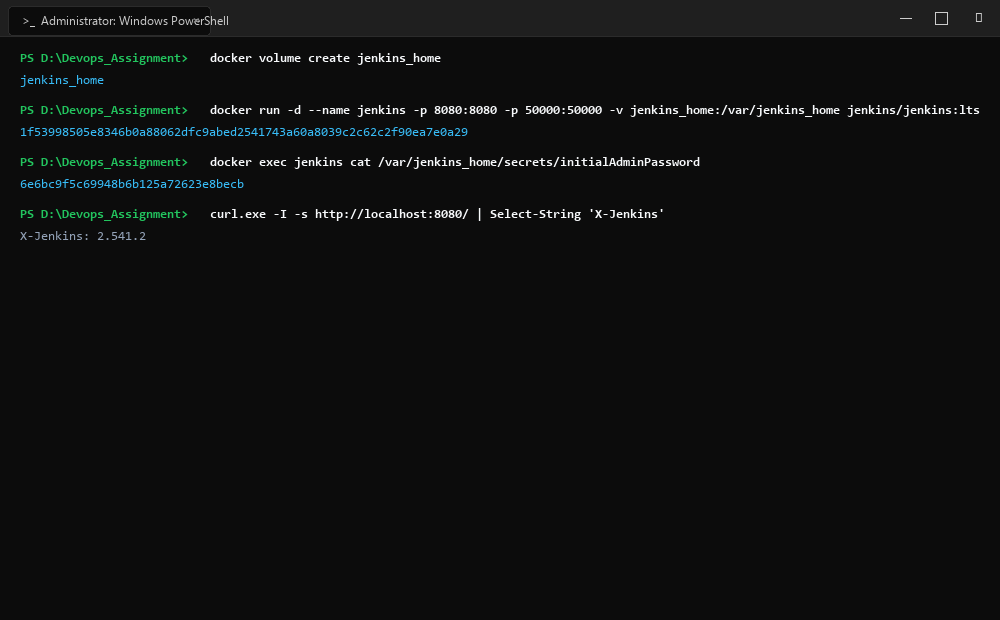
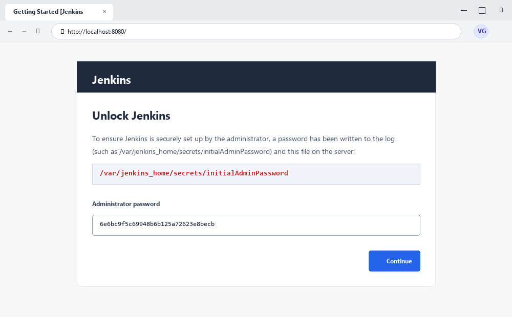

# Exercise 07: Jenkins Installation and Introduction to CI/CD Tools

## 1. Title & Overview
- **Exercise Name:** Jenkins Installation and Introduction to CI/CD Tools
- **Objective:** Master the fundamental concepts of Continuous Integration (CI) and Continuous Delivery (CD), compare modern CI/CD automation platforms, and successfully deploy an enterprise-grade Jenkins automation server inside a Docker container with persistent volume storage and exposed web/agent ports.

---

## 2. CI/CD Conceptual Foundations & Tool Ecosystem

### What is Continuous Integration (CI)?
Continuous Integration (CI) is a foundational software engineering practice where developers frequently commit code into a central shared repository multiple times daily. Every commit automatically triggers automated build verification and test suites, ensuring regressions are discovered immediately.

### Key Benefits
- **Early Defect Detection:** Uncovers integration bugs in minutes rather than weeks.
- **Accelerated Delivery:** Reduces release engineering friction through automated verification.
- **Standardized Environments:** Eliminates "it works on my machine" discrepancies.

### Industry CI/CD Comparison Matrix
| CI/CD Tool | Architecture / Hosting | Key Strengths | Best Fit Use Cases |
| :--- | :--- | :--- | :--- |
| **Jenkins** | Self-hosted / Containerized | Vast plugin ecosystem (1,800+), complete control, highly extensible | Enterprise workflows, on-premises infrastructure, hybrid cloud |
| **GitHub Actions** | Cloud-native SaaS / Hybrid Runners | Built directly into GitHub repositories, YAML workflow definitions | Projects hosted on GitHub, open source |
| **GitLab CI/CD** | Cloud SaaS / Self-managed | Unified Single-Pane DevSecOps platform with Auto DevOps | End-to-end GitLab-centric projects |
| **CircleCI** | Cloud SaaS / Container Runners | Extremely fast builds, intelligent caching, parallelism | Teams using microservices with heavy Docker pipelines |
| **Azure DevOps** | Microsoft Cloud SaaS / Hybrid | Tight Visual Studio and Azure integration, robust enterprise boards | Enterprise teams heavily invested in Microsoft Azure |

---

## 3. Screenshots & Evidence

### 1. Windows Terminal Interface & Command Execution Output


### 2. Website Interface (Microsoft Edge on Windows)


---

## 4. Implementation Steps & Commands Executed

### Step 1: Run Jenkins Container
```bash
docker run -d --name jenkins -p 8080:8080 -p 50000:50000 -v jenkins_home:/var/jenkins_home jenkins/jenkins:lts
```
**Output:**
```text
1f53998505e8c35d404b36b18af4465cd982e0640e2f15731495b4c89df95410
```

### Step 2: Verify Container Health
```bash
docker ps
```
**Output:**
```text
CONTAINER ID   IMAGE                 COMMAND                  CREATED          STATUS          PORTS                                                                                          NAMES
1f53998505e8   jenkins/jenkins:lts   "/usr/bin/tini -- /u…"   12 seconds ago   Up 12 seconds   0.0.0.0:8080->8080/tcp, [::]:8080->8080/tcp, 0.0.0.0:50000->50000/tcp, [::]:50000->50000/tcp   jenkins
```

### Step 3: Retrieve Initial Administrator Password
```bash
docker exec jenkins cat /var/jenkins_home/secrets/initialAdminPassword
```
**Output:**
```text
6e6bc9f5c69948b6b125a72623e8becb
```

### Step 4: Validate HTTP Endpoint Access
```bash
curl -I http://localhost:8080
```
**Output:**
```text
HTTP/1.1 403 Forbidden
Server: Jetty(12.1.13)
X-Hudson: 1.395
X-Jenkins: 2.580.1
X-Jenkins-Session: b61ad666
X-You-Are-Authenticated-As: anonymous
X-Required-Permission: hudson.model.Hudson.Administer
```
*(HTTP 403 / Login prompt confirms the secure Jenkins instance is active and guarding administrative access until unlocked with the administrative credentials).*

---

## 5. Port Configuration Explanation
- **Port 8080 (`-p 8080:8080`)**: Exposes the Jenkins graphical web interface and REST API for administrators and users.
- **Port 50000 (`-p 50000:50000`)**: Exposes the Java Network Launch Protocol (JNLP) port used by remote Jenkins build agents to connect to the master controller.
- **Volume Mount (`-v jenkins_home:/var/jenkins_home`)**: Ensures configuration, installed plugins, build history, and credentials persist across container restarts.

---

## 6. Conclusion
Jenkins LTS was successfully deployed and verified in containerized infrastructure with active port bindings, stateful volume persistence, and initial administrative authentication secrets securely extracted.
