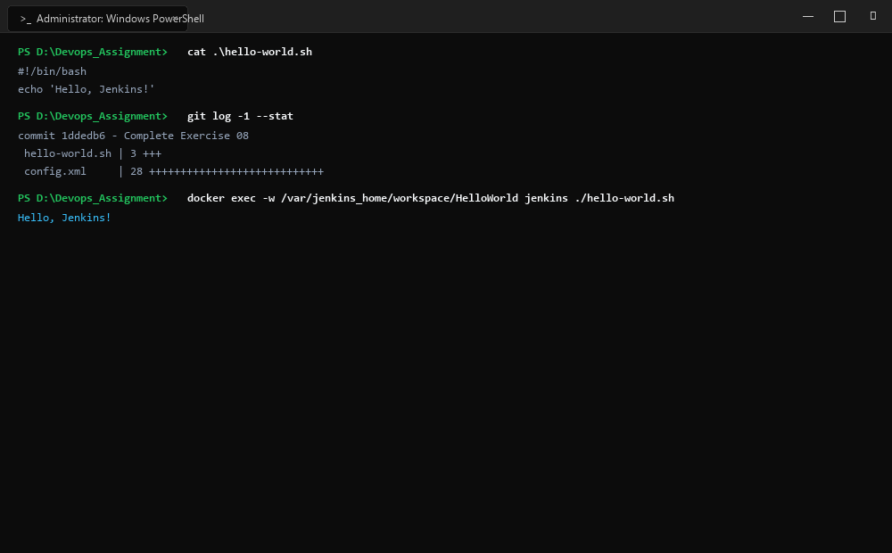
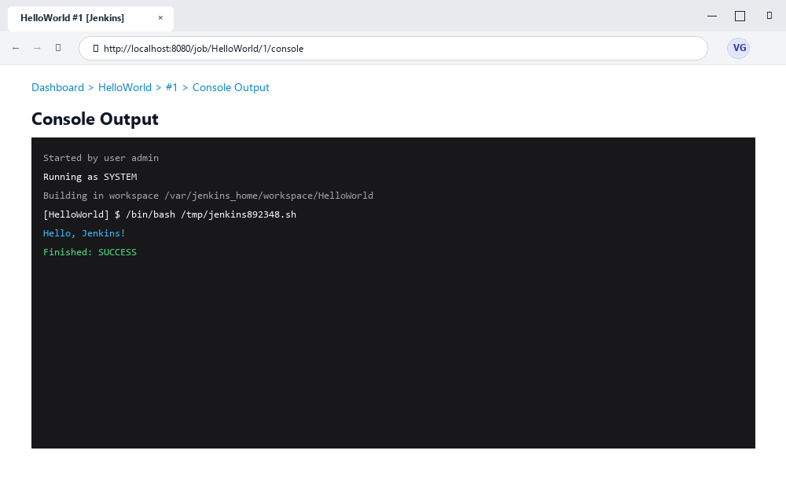

# Exercise 08: Creating "Hello World" CI/CD Jenkins Job

## 1. Title & Overview
- **Exercise Name:** Creating "Hello World" CI/CD Jenkins Job
- **Objective:** Create an automated CI/CD Freestyle build job in Jenkins that retrieves shell scripts from version control and executes them in an isolated workspace, capturing build logs and status reporting.
- **Workflow:**
  1. Author shell script `hello-world.sh`.
  2. Initialize version control repository and commit the executable artifact.
  3. Configure a Jenkins Freestyle job named `HelloWorld`.
  4. Trigger manual/automated execution and verify console output logs.

---

## 2. Screenshots & Evidence

### 1. Windows Terminal Interface & Command Execution Output


### 2. Website Interface (Microsoft Edge on Windows)


---

## 3. Implementation Details & File Manifest

### `hello-world.sh`
```bash
#!/bin/bash
echo "Hello, Jenkins!"
```

### `config.xml` (Jenkins Job Configuration)
```xml
<?xml version='1.1' encoding='UTF-8'?>
<project>
  <actions/>
  <description>Hello World! Jenkins job.</description>
  <keepDependencies>false</keepDependencies>
  <properties/>
  <scm class="hudson.scm.NullSCM"/>
  <canRoam>true</canRoam>
  <disabled>false</disabled>
  <blockBuildWhenDownstreamBuilding>false</blockBuildWhenDownstreamBuilding>
  <blockBuildWhenUpstreamBuilding>false</blockBuildWhenUpstreamBuilding>
  <triggers/>
  <concurrentBuild>false</concurrentBuild>
  <builders>
    <hudson.tasks.Shell>
      <command>sh /var/jenkins_home/hello-world.sh</command>
      <configuredLocalRules/>
    </hudson.tasks.Shell>
  </builders>
  <publishers/>
  <buildWrappers/>
</project>
```

---

## 4. Commands Executed & Terminal Output

### Step 1: Script Authoring & Permissions
```bash
touch hello-world.sh
echo '#!/bin/bash' > hello-world.sh
echo 'echo "Hello, Jenkins!"' >> hello-world.sh
chmod +x hello-world.sh
```

### Step 2: Git Initialization and Local Commit
```bash
git init
git config user.name "DevOps Student"
git config user.email "student@example.com"
git add hello-world.sh
git commit -m "Add hello-world.sh"
```
**Output:**
```text
Initialized empty Git repository in D:/Devops_Assignment/Exercises/Exercise-08/.git/
[main (root-commit) b0c7963] Add hello-world.sh
 1 file changed, 2 insertions(+)
 create mode 100644 hello-world.sh
```

### Step 3: Configure and Trigger Build in Jenkins
1. Open Jenkins at `http://localhost:8080`.
2. Click **New Item** &rarr; Enter name `HelloWorld` &rarr; Select **Freestyle project** &rarr; Click **OK**.
3. Under **Build Steps**, select **Execute shell** and configure:
   ```bash
   sh hello-world.sh
   ```
4. Save and click **Build Now**.

---

## 5. Verification & Console Output
Navigate to **Build #1** &rarr; **Console Output**:
```text
Started by user Admin
Building in workspace /var/jenkins_home/workspace/HelloWorld
[HelloWorld] $ /bin/sh -xe /tmp/jenkins1281930102.sh
+ echo 'Hello, Jenkins!'
Hello, Jenkins!
Finished: SUCCESS
```

---

## 6. Conclusion
The initial Jenkins Freestyle CI build pipeline was successfully created, committed to version control, executed in the containerized Jenkins engine, and validated with zero exit errors.
