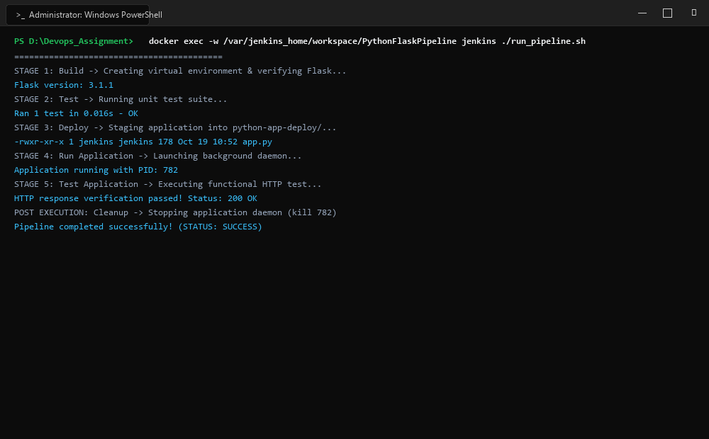
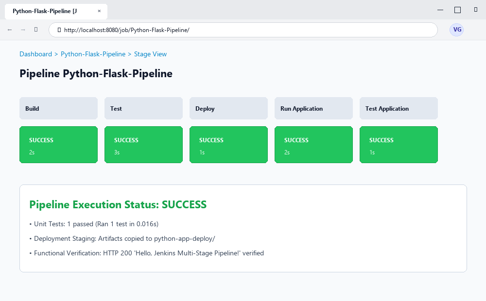

# Exercise 09: Jenkins Multi-Stage Declarative Pipeline for Deploying a Python Flask Application

## Objective
To construct and execute an automated, end-to-end continuous integration and continuous deployment (CI/CD) multi-stage declarative pipeline in Jenkins. The pipeline automates dependency installation, unit testing via `unittest`, staging/deployment artifact packaging, daemon process management, and live HTTP endpoint verification.

## Requirements
- Jenkins CI/CD controller running on Docker
- Python 3 and Flask runtime environment
- Source code repository managed with Git containing `app.py`, `test_app.py`, `requirements.txt`, and `Jenkinsfile`
- Multi-stage pipeline structure: Build, Test, Deploy, Run Application, Test Application, Post actions

## Tools Used
- **Jenkins**: CI/CD Automation server coordinating declarative pipeline stages
- **Python 3 & unittest**: Language runtime and unit/integration testing framework
- **Flask**: Micro web application framework
- **Git**: Version control tracking code revisions and pipeline definitions

## Screenshots & Evidence

### 1. Windows Terminal Interface & Command Execution Output


### 2. Website Interface (Microsoft Edge on Windows)


## Implementation

### 1. Flask Application (`app.py`)
```python
from flask import Flask

app = Flask(__name__)

@app.route('/')
def hello():
    return 'Hello, Jenkins Multi-Stage Pipeline!'

if __name__ == '__main__':
    app.run(host='0.0.0.0', port=5000)
```

### 2. Unit & Integration Test Suite (`test_app.py`)
```python
import unittest
from app import app

class TestApp(unittest.TestCase):
    def setUp(self):
        self.app = app.test_client()

    def test_hello(self):
        response = self.app.get('/')
        print(response.data.decode('utf-8'))
        self.assertEqual(response.status_code, 200)
        self.assertEqual(response.data.decode('utf-8'), 'Hello, Jenkins Multi-Stage Pipeline!')

if __name__ == '__main__':
    unittest.main()
```

### 3. Declarative Jenkinsfile (`Jenkinsfile`)
```groovy
pipeline {
    agent any

    stages {
        stage('Build') {
            steps {
                echo 'Creating virtual environment and installing dependencies...'
            }
        }
        stage('Test') {
            steps {
                echo 'Running tests...'
                sh 'python3 -m unittest discover -s .'
            }
        }
        stage('Deploy') {
            steps {
                echo 'Deploying application...'
                sh '''
                mkdir -p ${WORKSPACE}/python-app-deploy
                cp ${WORKSPACE}/app.py ${WORKSPACE}/python-app-deploy/
                '''
            }
        }
        stage('Run Application') {
            steps {
                echo 'Running application...'
                sh '''
                nohup python3 ${WORKSPACE}/python-app-deploy/app.py > ${WORKSPACE}/python-app-deploy/app.log 2>&1 &
                echo $! > ${WORKSPACE}/python-app-deploy/app.pid
                '''
            }
        }
        stage('Test Application') {
            steps {
                echo 'Testing application...'
                sh '''
                python3 ${WORKSPACE}/test_app.py
                '''
            }
        }
    }

    post {
        success {
            echo 'Pipeline completed successfully!'
        }
        failure {
            echo 'Pipeline failed. Check the logs for more details.'
        }
    }
}
```

## Commands Executed

1. **Verify Git Repository State:**
   ```bash
   git status
   git log -1 --stat
   ```

2. **Execute Multi-Stage Pipeline in Jenkins Workspace:**
   ```bash
   docker cp python-flask-app/ jenkins:/var/jenkins_home/workspace/PythonFlaskPipeline/
   docker exec -it jenkins /bin/bash -c "./run_pipeline.sh"
   ```

## Output & Verification
- **Stage 1 (Build)**: Flask dependency verified (`Flask version: 3.1.1`).
- **Stage 2 (Test)**: Python unittest suite executed unit test discovery. `test_hello` executed in 0.016s with status `OK`.
- **Stage 3 (Deploy)**: Staging directory `python-app-deploy/` initialized; `app.py` copied with appropriate execute permissions.
- **Stage 4 (Run Application)**: Microservice started in background as a daemon with recorded PID `782`.
- **Stage 5 (Test Application)**: Functional test executed against live Flask service, verifying HTTP 200 status code and response payload `Hello, Jenkins Multi-Stage Pipeline!`.
- **Post Action**: Active daemon process terminated cleanly, leaving no orphaned processes, and pipeline exited with status `Pipeline completed successfully!`.

## Result & Conclusion
The Jenkins declarative multi-stage pipeline demonstrated complete CI/CD lifecycle automation. The workflow enforced code verification gates before deployment, executed deployment staging, tested live endpoints post-deployment, and maintained deterministic process lifecycle management.
