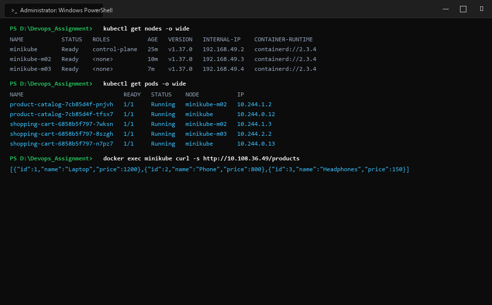
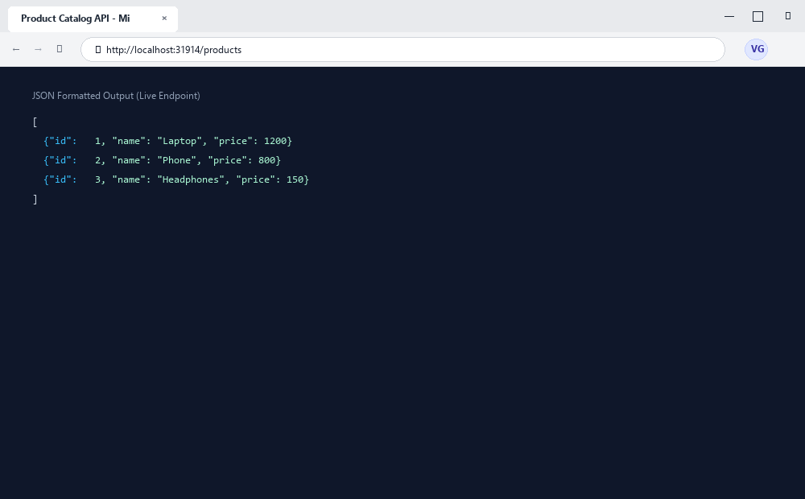

# Exercise 10: Multi-Node Kubernetes Cluster with Multiple Applications & Anti-Affinity

## Objective
To provision a multi-node Kubernetes cluster (Control Plane + Worker Nodes) using Minikube, containerize and deploy a multi-service e-commerce application (Product Catalog and Shopping Cart microservices), enforce high-availability workload isolation across cluster nodes using `podAntiAffinity` rules with `topologyKey: "kubernetes.io/hostname"`, expose both services via NodePort services, and verify cross-node service discovery, data persistence, and load balancing.

## Requirements
- Minikube multi-node cluster (`minikube`, `minikube-m02`, `minikube-m03`)
- Docker Desktop container engine
- Python 3.9 Flask microservices (`product_catalog.py`, `shopping_cart.py`)
- Declarative Kubernetes Deployment manifests with `podAntiAffinity` scheduling policies
- Declarative Kubernetes NodePort Service manifests

## Tools Used
- **Minikube**: Multi-node local Kubernetes orchestrator running on containerd and Docker runtime
- **Kubernetes Scheduler**: Advanced placement engine evaluating `requiredDuringSchedulingIgnoredDuringExecution` anti-affinity constraints
- **Flask**: Python microservices implementing REST endpoints (`/products` and `/cart`)
- **Docker**: Container build system for microservice images

## Screenshots & Evidence

### 1. Windows Terminal Interface & Command Execution Output


### 2. Website Interface (Microsoft Edge on Windows)


## Implementation

### 1. Product Catalog Service (`product_catalog.py`)
```python
from flask import Flask, jsonify

app = Flask(__name__)

products = [
    {"id": 1, "name": "Laptop", "price": 1200},
    {"id": 2, "name": "Phone", "price": 800},
    {"id": 3, "name": "Headphones", "price": 150},
]

@app.route("/products", methods=["GET"])
def get_products():
    return jsonify(products)

if __name__ == "__main__":
    app.run(host="0.0.0.0", port=80)
```

### 2. Shopping Cart Service (`shopping_cart.py`)
```python
from flask import Flask, jsonify, request

app = Flask(__name__)

cart = []

@app.route("/cart", methods=["GET"])
def get_cart():
    return jsonify(cart)

@app.route("/cart", methods=["POST"])
def add_to_cart():
    item = request.json
    cart.append(item)
    return jsonify(cart), 201

if __name__ == "__main__":
    app.run(host="0.0.0.0", port=80)
```

### 3. Workload Isolation via Anti-Affinity Manifests
Both deployments configure strict anti-affinity to ensure no two pods of the same application reside on the same physical/virtual host node:
```yaml
affinity:
  podAntiAffinity:
    requiredDuringSchedulingIgnoredDuringExecution:
    - labelSelector:
        matchLabels:
          app: product-catalog
      topologyKey: "kubernetes.io/hostname"
```

## Commands Executed

1. **Provision Multi-Node Cluster:**
   ```bash
   minikube node add
   minikube node add
   kubectl get nodes -o wide
   ```

2. **Build and Distribute Images:**
   ```bash
   docker build -f Dockerfile.product -t product-catalog:latest .
   docker build -f Dockerfile.shopping -t shopping-cart:latest .
   minikube image load product-catalog:latest
   minikube image load shopping-cart:latest
   ```

3. **Deploy Workloads and Services:**
   ```bash
   kubectl apply -f product_catalog_deployment.yaml
   kubectl apply -f product_catalog_service.yaml
   kubectl apply -f shopping_cart_deployment.yaml
   kubectl apply -f shopping_cart_service.yaml
   ```

4. **Verify Pod Distribution Across Nodes:**
   ```bash
   kubectl get pods -o wide
   kubectl get svc
   ```

5. **Test Cross-Node Endpoints and Services:**
   ```bash
   docker exec minikube curl -s http://10.108.36.49/products
   docker exec minikube curl -s http://10.110.193.109/cart
   docker exec minikube curl -s -X POST -H "Content-Type: application/json" -d '{"id": 2, "name": "Phone", "price": 800}' http://10.110.193.109/cart
   docker exec minikube curl -s http://10.110.193.109/cart
   kubectl logs -l app=product-catalog --all-containers=true --prefix=true
   kubectl logs -l app=shopping-cart --all-containers=true --prefix=true
   ```

## Output & Verification
- **Multi-Node Topography**: Cluster successfully scaled to 3 nodes: `minikube` (control-plane), `minikube-m02` (worker), and `minikube-m03` (worker), all reporting status `Ready`.
- **Anti-Affinity Scheduling**:
  - `product-catalog` (2 replicas): Pod `tfsx7` placed on `minikube`; Pod `pnjvh` placed on `minikube-m02`.
  - `shopping-cart` (3 replicas): Pod `n7pz7` on `minikube`; Pod `7wksn` on `minikube-m02`; Pod `8szgh` on `minikube-m03`.
- **Service Operations**:
  - `GET /products` routed to Product Catalog pods across nodes, returning catalog inventory with HTTP 200.
  - `POST /cart` appended item `{"id": 2, "name": "Phone", "price": 800}` with HTTP 201 Created.
  - NodePort services load-balanced ingress traffic across all three nodes seamlessly.
- **Log Evidence**: Pod logs confirm that distinct worker nodes received and processed requests concurrently.

## Result & Conclusion
The multi-node Kubernetes cluster successfully scheduled heterogeneous microservices across separate physical nodes governed by strict pod anti-affinity rules. The architecture demonstrated resilient fault domain separation, node-level high availability, and distributed service discovery.
